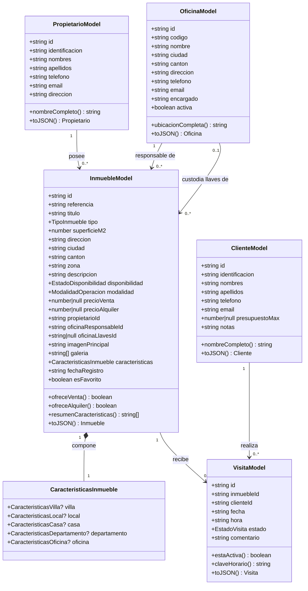

# Documentación Técnica y Análisis de Dominio · InmoGestión 360

**Universidad Técnica de Machala**  
**Facultad de Ingeniería Civil · Carrera de Tecnologías de la Información**  
**Asignatura:** Programación Móvil  
**Tecnología:** Angular 22 (componentes standalone, Signals, Reactive Forms, Router, LocalStorage)

---

## 1. Análisis del Dominio y Modelado (RF-01)

La agencia inmobiliaria **InmoGestión 360** opera con oficinas en distintos cantones del Ecuador y requiere centralizar la administración de propiedades, propietarios, sucursales, control de custodia de llaves, clientes interesados y agenda de visitas.

### Entidades identificadas y justificación de clases

| Entidad / Clase | Archivo | Identificador único | Responsabilidad en el dominio |
| :--- | :--- | :--- | :--- |
| `OficinaModel` | `src/app/models/oficina.model.ts` | `id` (`OFI-XX`), `codigo` único | Representa una sucursal cantonal. Puede ser **oficina responsable** de uno o más inmuebles y/o **oficina custodia de llaves**. |
| `PropietarioModel` | `src/app/models/propietario.model.ts` | `id` (`PROP-XX`), `identificacion` única | Dueño legal de uno o varios inmuebles. Se protege su eliminación mientras existan inmuebles asociados. |
| `InmuebleModel` | `src/app/models/inmueble.model.ts` | `id` (`INM-XX`), `referencia` única | Entidad central del negocio. Encapsula modalidad (`Venta`, `Alquiler`, `Ambas`), precios independientes, galería de imágenes, relaciones con propietario/oficinas y características tipadas según el tipo de propiedad. |
| `CaracteristicasInmueble` | `src/app/models/inmueble.model.ts` | Composición 1:1 en `InmuebleModel` | Interfaces tipadas específicas por categoría: `CaracteristicasVilla`, `CaracteristicasLocal`, `CaracteristicasCasa`, `CaracteristicasDepartamento` y `CaracteristicasOficina`. |
| `ClienteModel` | `src/app/models/cliente.model.ts` | `id` (`CLI-XX`), `identificacion` única | Persona natural o jurídica interesada en visitar, comprar o alquilar propiedades. |
| `VisitaModel` | `src/app/models/visita.model.ts` | `id` (`VIS-XX`), clave lógica `(inmuebleId, fecha, hora)` | Registra una cita comercial entre un cliente y un inmueble, su estado (`Programada`, `Reprogramada`, `Realizada`, `Cancelada`) y observaciones/impresión. |
| `FiltroGuardado` | `src/app/models/filtros.model.ts` | `id` (`FLT-...`) | Almacena combinaciones personalizadas de filtros avanzados para reutilización rápida. |

### Justificación de colecciones y relaciones (cardinalidades)

- **Propietario (1) — (0..\*) Inmueble:** Un propietario puede ofrecer múltiples inmuebles (ej. Luis Herranz posee casas, departamento y local), pero cada inmueble pertenece exactamente a un propietario (`propietarioId`).
- **Oficina (1) — (0..\*) Inmueble [Responsable]:** Cada inmueble es gestionado obligatoriamente por una oficina responsable (`oficinaResponsableId`).
- **Oficina (0..1) — (0..\*) Inmueble [Custodia de llaves]:** Un inmueble puede tener sus llaves custodiadas en la misma oficina responsable, en otra sucursal distinta, o permanecer en poder del propietario (`oficinaLlavesId: string | null`).
- **Inmueble (1) — (0..\*) Visita:** Un inmueble acumula múltiples visitas históricas y activas; las visitas activas no pueden coincidir en fecha y hora sobre el mismo inmueble.
- **Cliente (1) — (0..\*) Visita:** Un cliente puede agendar visitas a varios inmuebles (e incluso visitar el mismo inmueble en distintas fechas para seguimiento).
- **Uso de colecciones tipadas (`OficinaModel[]`, `PropietarioModel[]`, `InmuebleModel[]`, `ClienteModel[]`, `VisitaModel[]`) gestionadas mediante `signal<T[]>` y `computed()`:** Permite consultas inmutables sin alterar el arreglo maestro, tipado estricto en TypeScript y actualización automática e instantánea de KPIs y gráficos del dashboard.

---

## 2. Diagrama de Clases UML



---

## 3. Arquitectura de Carpetas, Componentes y Servicios

```text
src/app/
├── data/
│   └── seed-data.ts                 # 18 inmuebles, 6 propietarios, 4 oficinas, 7 clientes, 16 visitas
├── models/
│   ├── enums.ts                     # Tipos, modalidades, estados y catálogo de equipamiento
│   ├── oficina.model.ts             # Interfaz + clase OficinaModel
│   ├── propietario.model.ts         # Interfaz + clase PropietarioModel
│   ├── cliente.model.ts             # Interfaz + clase ClienteModel
│   ├── inmueble.model.ts            # Interfaces de características + clase InmuebleModel
│   ├── visita.model.ts              # Interfaz + clase VisitaModel
│   ├── filtros.model.ts             # Filtros avanzados, filtros guardados y métricas Dashboard
│   └── index.ts
├── services/
│   ├── storage.service.ts           # Persistencia transparente en localStorage
│   ├── notification.service.ts      # Mensajes toast reactivos
│   └── inmobiliaria.service.ts      # Estado global con Signals, CRUD, reglas de negocio, consultas y CSV/JSON
├── shared/
│   ├── confirm-dialog.component.ts  # Modal accesible de confirmación antes de eliminar/restaurar
│   ├── toast-container.component.ts # Contenedor de notificaciones en pantalla
│   ├── img-fallback.directive.ts    # Directiva appImgFallback ante URLs de imagen fallidas
│   └── precio-ec.pipe.ts            # Formato monetario estándar ($ 95.000 / $ 650/mes)
└── pages/
    ├── dashboard/                   # KPIs dinámicos + 3 gráficos + indicadores por oficina
    ├── catalogo/                    # Catálogo tarjetas/tabla + consultas avanzadas + paginación + favoritos
    ├── inmueble-detalle/            # Detalle completo, galería interactiva, oficina/llaves e historial de visitas
    ├── mantenimiento/               # CRUD de inmuebles, propietarios, oficinas y clientes con validaciones
    ├── visitas/                     # Programación, reprogramación, realización, cancelación y control de choques
    ├── reportes/                    # Resumen filtrable, exportación CSV/JSON y ficha técnica imprimible
    └── not-found/                   # Gestión de rutas inexistentes (404)
```

### Decisiones de diseño y persistencia

1. **Separación estricta de responsabilidades:** Toda la lógica de negocio (validación de unicidad, coherencia de precios según modalidad, integridad referencial en bajas, bloqueo de choques de visitas, consultas combinables inmutables y cálculo de indicadores) reside en `InmobiliariaService`. Los componentes standalone se limitan a la interacción de interfaz y formularios reactivos.
2. **Reactividad con Angular Signals (`signal`, `computed`, `effect`):** Al registrar, modificar o eliminar cualquier inmueble, propietario, oficina o visita, los indicadores y gráficos del Dashboard se recalculan de forma inmediata y los `effect()` sincronizan automáticamente los cambios con `localStorage` bajo el prefijo `inmogestion360_v1_`.
3. **Resiliencia visual:** Cada propiedad utiliza ilustraciones arquitectónicas SVG locales de carga inmediata en `public/images/` y permite ingresar URLs externas; si alguna imagen falla al cargar, la directiva `appImgFallback` sustituye automáticamente el recurso por `images/fallback-inmueble.svg`.
4. **Impresión nativa limpia:** Las hojas de estilo `@media print` ocultan la barra de navegación y controles auxiliares para imprimir directamente la ficha técnica (`/reportes/ficha/:id`) o el resumen filtrable (`/reportes`).

---

## 4. Guía para Demostrar los Casos de Consulta (Sección 7)

1. **Casas disponibles para venta en Machala en rango de precios:** Ir a **Catálogo y Consultas**, pulsar el acceso rápido *«Casas venta Machala ($80k–$150k)»* o seleccionar `Ciudad = Machala`, `Tipo = Casa`, `Modalidad = Venta`, `Disponibilidad = Disponible`, `Precio mín. = 80000`, `Precio máx. = 150000`.
2. **Villas de una ciudad con superficie mínima y características específicas:** Seleccionar `Tipo = Villa`, elegir la `Ciudad` (ej. Pasaje, Machala o Guayaquil), definir `Superficie mín. = 220` y `Equipamiento = Piscina` (o usar el botón *«Villas ≥ 220 m² con piscina»*).
3. **Inmuebles disponibles en alquiler ordenados de menor a mayor canon:** Seleccionar `Modalidad = Alquiler`, `Disponibilidad = Disponible` y `Ordenar por = Canon alquiler (menor a mayor)` (o pulsar *«Disponibles alquiler (canon ↑)»*).
4. **Visitas programadas de un inmueble y sus observaciones:** Ir a **Visitas** y filtrar en *«Historial por inmueble»* (ej. `REF-1002`), o abrir el **Detalle** del inmueble en el catálogo.
5. **Oficina responsable y ubicación de llaves:** Visible en las tarjetas/tabla del catálogo, en el panel **Gestión de oficina y llaves** del detalle (ej. `REF-1003` tiene oficina responsable en Machala y llaves custodiadas en Sucursal Pasaje; `REF-1007` indica llaves en poder del propietario) y en la **Ficha imprimible**.
6. **Actualización dinámica de estadísticas del Dashboard:** Observar los totales y gráficos en **Dashboard**, luego registrar, editar o eliminar un inmueble o visita en **Mantenimiento** / **Visitas** y regresar al **Dashboard** para verificar el recálculo automático y su persistencia tras recargar el navegador (`F5`).
